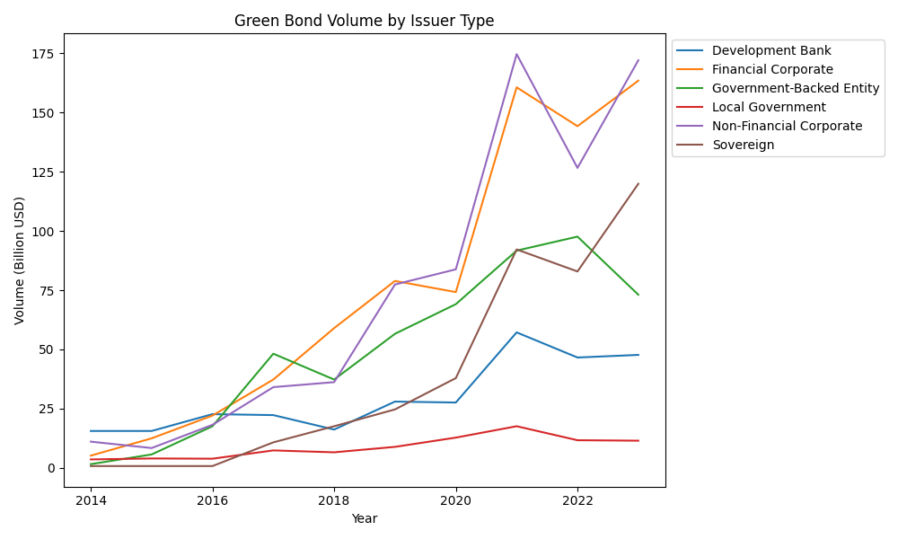
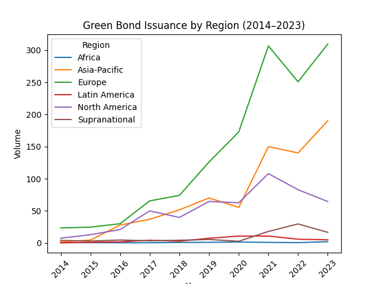
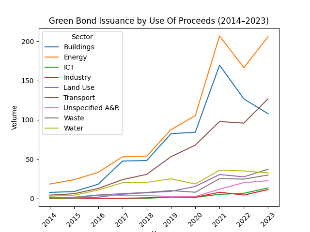
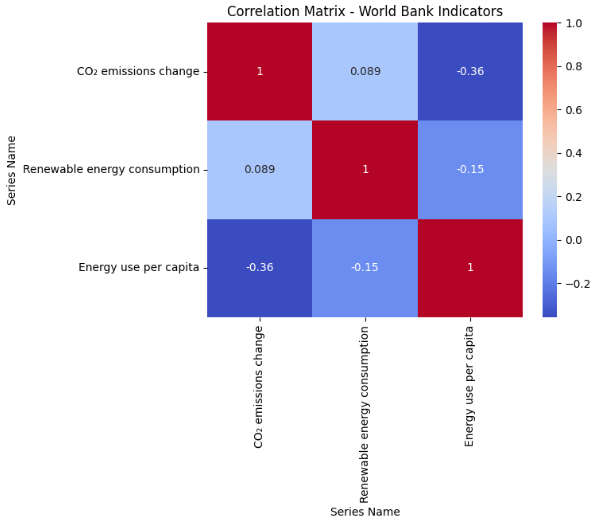

# 🌱 Sustainable Finance Research: Green Bonds and Decarbonisation

A data-driven study of the **global green bond market (2014–2023)**: who issues green bonds, where, in which currencies, and what the money funds. It's set alongside **World Bank energy and emissions data for 14 major economies**, to test how energy use and renewable energy relate to CO₂ emissions.

| | |
|---|---|
| **Market data** | [Climate Bonds Initiative](https://www.climatebonds.net/): green bond issuance, 2014–2023 |
| **Macro data** | [World Bank World Development Indicators](https://databank.worldbank.org/source/world-development-indicators), 2014–2023 |
| **Methods** | Data reshaping, trend analysis, correlation analysis, OLS regression, web scraping |
| **Stack** | Python · Pandas · Seaborn · Matplotlib · Statsmodels · scikit-learn · Selenium · BeautifulSoup |

---

## 📌 Key findings

### 1. The green bond market grew about 16× in a decade

| Year | Global green bond issuance |
|---|---|
| 2014 | **$37.0B** |
| 2017 | $160.1B |
| 2020 | $305.4B |
| 2021 | **$593.9B** (peak) |
| 2023 | **$587.6B** |

- **Europe leads.** It issued **$309.6B in 2023**, more than half the global total.
- **Asia-Pacific grew the fastest**, from **$1.6B (2014) to $190.2B (2023)**.
- **EUR is the main currency** ($260.3B in 2023), ahead of USD ($127.0B) and CNY ($79.2B). **INR issuance jumped to $12.7B in 2023**, from under $1B every year before.
- **Governments joined at scale.** Sovereign issuance grew from nothing before 2016 to **$119.9B in 2023**.
- **Large deals dominate.** Issues of **$1B+** made up $276.9B of 2023 volume, the biggest deal-size bucket.

### 2. Energy is what green bonds fund most

| Use of proceeds (2023) | Issuance |
|---|---|
| Energy | **$205.7B** |
| Transport | $126.8B |
| Buildings | $107.7B |
| Land use | $37.1B |
| Water | $32.5B |
| Waste | $29.8B |

### 3. Emissions are tied more to how much energy a country uses than to its renewable share

An OLS regression across 14 countries over 2014–2023 (`CO₂ emissions change since 1990 ~ renewable energy share + energy use per capita`) found:

| Variable | Coefficient | p-value | Significant? |
|---|---|---|---|
| Energy use per capita (kg oil eq.) | **−0.0237** | **< 0.001** | ✅ Yes |
| Renewable energy share (% of final energy) | +0.364 | 0.651 | ❌ No |
| Intercept | 138.06 | < 0.001 | ✅ |

**R² = 0.129** (adjusted R² = 0.116).

- **How to read this:** in this panel, the renewable energy share alone doesn't significantly explain differences in emissions growth. The negative energy-use coefficient is driven mainly by **China (+449%) and India (+392%)**. Their emissions grew the most since 1990, from low-to-moderate per-capita energy use (about 2,700 and 700 kg oil equivalent).
- **Latest CO₂ change since 1990, by country:**
  - **Fell sharply:** the UK (−48%), Germany (−43%), Sweden (−38%), Italy (−28%), France (−27%), the Netherlands (−26%) and Japan (−19%).
  - **Still rose despite high energy use:** Singapore (+80%), Australia (+35%) and Canada (+31%).
- **Why renewables alone don't explain it:** India gets 35% of its final energy from renewables and still grew emissions by +392%. Sweden (58% renewables) cut them by 38%.
- **Caveat:** the low R² means most of the variation comes from factors not in the model, such as economic growth, the energy mix within fossil fuels, and policy. This is a descriptive starting point, not a causal claim.

---

## 🗂️ Data

### Climate Bonds Initiative (`ClimateBonds-*.csv`)
Global green bond issuance by year (2014–2023), in **USD billions**. The deal-size file is in raw USD.

| File | Breakdown |
|---|---|
| `ClimateBonds-currency-issued.csv` | Currency (EUR, USD, CNY, GBP, SEK, INR, CAD, JPY, SGD, …) |
| `ClimateBonds-deal-size.csv` | Deal size (0–100M, 100–500M, 500M–1B, 1B+) |
| `ClimateBonds-issuer-type.csv` | Issuer type (development bank, financial corporate, government-backed entity, local government, non-financial corporate, sovereign) |
| `ClimateBonds-market-issued.csv` | Market (developed, emerging, supranational) |
| `ClimateBonds-region-issued.csv` | Region (Africa, Asia-Pacific, Europe, Latin America, North America, supranational) |
| `ClimateBonds-uop-issued.csv` | Use of proceeds (energy, buildings, transport, water, waste, land use, industry, ICT, …) |

### World Bank (`worldbankfin.csv`)
**14 countries:** Australia, Canada, China, France, Germany, India, Italy, Japan, Netherlands, Singapore, Spain, Sweden, United Kingdom, United States.

**3 indicators (2014–2023):**
- CO₂ emissions excluding LULUCF (% change from 1990)
- Energy use (kg of oil equivalent per capita)
- Renewable energy consumption (% of total final energy consumption)

### Bond-level scraper (`climatebonds.py`)
A headless **Selenium (Edge) + BeautifulSoup** scraper for the Climate Bonds Initiative bond database. It collects bond ID, issuer, amount, currency, issue and maturity dates, CBI certification and second-party-opinion provider, and saves them to `green_bonds.csv` for bond-level analysis.

---

## 🔬 Methodology (`sustainanlytics.ipynb`)

1. **Reshaping the World Bank data:** wide → long (`melt`), extract the year, convert to numbers, then pivot to one row per country-year with one column per indicator.
2. **Filling gaps:** forward-fill within each country for missing recent years. Gaps in the Climate Bonds tables are back-filled across years.
3. **Typing:** category columns (currency, issuer type, market, region, sector) are converted to Pandas categoricals.
4. **Descriptive and trend analysis:** issuance over time by issuer type, region and use of proceeds, plus a 7 × 2 grid of per-country charts comparing CO₂ change with renewable share.
5. **Correlation analysis:** a heatmap of CO₂ change, renewable share and energy use per capita.
6. **Regression:** Statsmodels OLS with an intercept. Results are exported to `ols_regression_results.csv`.

---

## 📈 Charts

| | |
|---|---|
|  |  |
|  |  |

Per-country CO₂ vs renewables trends: [`trendbycountry.png`](trendbycountry.png), [`trendbycountry1.png`](trendbycountry1.png), [`trendbycountry2.png`](trendbycountry2.png) and [`worldbank_plots.png`](worldbank_plots.png).

---

## 🧱 Repository structure

```
sustainable_finance_research/
├── sustainanlytics.ipynb          # Full analysis notebook
├── climatebonds.py                # Selenium + BeautifulSoup scraper for CBI bond data
├── ClimateBonds-*.csv             # 6 market breakdowns, 2014–2023
├── worldbankfin.csv               # World Bank indicators, 14 countries
├── ols_regression_results.csv     # Exported regression coefficients
└── *.png                          # Saved charts
```

---

## 🚀 Run it yourself

```bash
git clone https://github.com/sanskreate/sustainable_finance_research.git
cd sustainable_finance_research
pip install pandas matplotlib seaborn statsmodels scikit-learn jupyter
jupyter notebook sustainanlytics.ipynb
```

To run the scraper, also `pip install selenium beautifulsoup4`, download the Microsoft Edge WebDriver that matches your Edge version, and update `executable_path` in `climatebonds.py`.

---

## 🔭 Possible next steps

- Link green bond issuance per country to that country's emissions path (a panel regression with lags).
- Add GDP, carbon pricing and fossil-fuel mix as controls to raise explanatory power.
- Use the scraped bond-level data to compare certified and uncertified bonds, and price differences (the "greenium").

---

👩‍💻 **Author:** [Sanskriti Rai](https://www.linkedin.com/in/sanskreate/) · [sanskritirai.live](https://sanskritirai.live)
